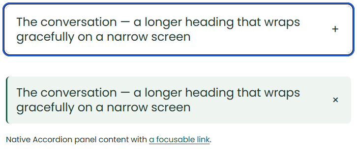
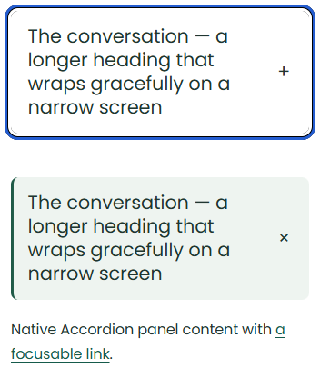

# SE-029 — Runner headings and native Gutenberg block styling

Implemented on 23 November 2026 for [Core issue #19](https://github.com/the1path/sprint-engine/issues/19).
Review and owner staging acceptance remain separate. This is unreleased source;
published 0.3.0 does not acquire SE-029 or the separate SE-028 action merely by
sharing the development source's version number.

## Source and changes

Latest `origin/main` was fetched and verified before branching: `ecce156d6b37f418839672a920c47946c15f9dd3`
(SE-028, PR #18). The checkout was clean and local `main` matched the fetched
branch. Work uses `codex/se-029-runner-heading-accordion-styles`.

| File | Change |
| --- | --- |
| `assets/css/runner.css` | Scoped H2–H6 defaults and native Accordion toggle presentation. |
| `tests/browser/blocks-fixture.php` | Disposable, WordPress-rendered block content on Welcome, Step and saved administrator Preview; retention snapshot. |
| `tests/browser/blocks.cjs` | Three-engine visual, computed-style, layout and native interaction matrix. |
| `docs/development.md`, `docs/README.md` | Behaviour, version availability and repeatable test instructions. |
| This record and its representative screenshots | Evidence, limitations and staging handoff. |

Sprint/Step title tags and sizes, Runner geometry, WordPress markup/content
filters/scripts, Core/Pro hooks, progress/access/REST services, database and
branding settings interfaces are unchanged. No Pro files changed. Plugin version
and Stable tag remain **0.3.0**, schema **2**, PHP minimum **8.0**, WordPress
minimum **6.0**. No merge, deployment, release, tag, packaging or publication was
performed.

## Root cause and presentation decisions

A real WordPress render with the old stylesheet and the fixture's late-loaded
Hello-like reset reproduced H2 **24px** versus H3 **32px**. The unscoped theme
`:focus` button rule also changed a clicked native Accordion toggle to
`rgb(204, 51, 102)` while `aria-expanded` was true. Its markup contains a native
button, title span and `aria-hidden` icon span, not a Details summary.

Content heading defaults now descend independently of application titles:

| Width | H2 | H3 | H4 | H5 | H6 |
| --- | ---: | ---: | ---: | ---: | ---: |
| 1440 CSS px | 28px | 24px | 19.2px | 17.6px | 16px |
| 320 CSS px | 24px | 20.8px | 19.2px | 17.6px | 16px |

The H2/H3 sizes interpolate with `clamp()`. Low-specificity heading defaults
leave inline sizes, WordPress font-size presets, font families, colours and
explicit margins effective. WordPress's own fluid conversion of a custom size
is retained rather than replaced with a fixed pixel size. Accordion headings
follow the same default scale, while an explicitly sized ancestor block can
still supply their inherited typography. Sprint title remains 29.6px and Step
title 36px at the 1440px test width.

Only the native `.wp-block-accordion-heading__toggle` and its title/icon spans
receive the new control styles. Flex layout reserves the icon's width, permits
title wrapping and follows native DOM order/direction for both icon positions.
No CSS `order`, icon replacement, rotation override or JavaScript controller is
introduced. WordPress continues to manage `aria-expanded`, panel visibility,
`is-open`, native icon rotation and keyboard activation.

With default branding, collapsed background is transparent; hover/expanded uses
`rgb(238, 244, 240)`, active uses the secondary hover colour, and expanded has a
`rgb(32, 91, 72)` inline-start border. Returning to collapsed restores its
background even when the button stays focused. Explicit block backgrounds remain
visible through the transparent toggle. Keyboard `:focus-visible` has the blue
3px outline and separate white/black two-tone ring in either state. WebKit's
native pointer-click policy may leave a button unfocused; the suite also focuses
that closed control explicitly and tests real Tab entry separately.

Details was inspected separately: its summary remains `display: list-item`,
retains the browser disclosure marker, toggles with pointer/Space/Enter, and
receives the existing Runner focus ring. No Details-specific CSS was needed.

Native [Accordion arrived in WordPress 6.9](https://developer.wordpress.org/news/2025/10/styling-accordions-in-wordpress-6-9/);
Details arrived in 6.3. Older Core-supported WordPress installations cannot author
those absent native blocks without an independent backport. The fixture checks
the block registry and reports these cases as NOT RUN, with no Core polyfill.

## Executed compatibility matrix

The finite fixture contains H2–H6, preset/custom typography and colours, paragraph,
ordered/unordered lists, quote, filled/outline/custom Buttons, Details, native
Accordion (left/right/hidden icons, initially collapsed/expanded, custom heading
colour/padding/size and parent font preset), group/columns, table, image/gallery,
File download, audio, video, iframe embed, code and preformatted content.

Every engine/profile/surface runs at **1440, 768, 390 and 320 CSS px**, in **LTR
and RTL**. Each also checks 200% root text enlargement at 320px in both directions.
Pointer, active, persistent focus, Tab, Enter and Space checks run at 1440/390px.
Initially open panels and panels opened by native interaction are checked against
their ARIA controls, `hidden` state (including `hidden="until-found"`) and class.
Checks assert no horizontal overflow, icon displacement/shrinkage or clipped
media, 48px Accordion touch targets, retained authored styles and no browser
script errors or presentation-triggered writes.

| Profile | Meaning |
| --- | --- |
| `neutral` | Twenty Twenty-Five supplies WordPress Global Styles/block assets; theme stylesheet responses are emptied in the test browser. |
| `hello-reset` | The same baseline plus the checked-in representative Hello Elementor-like button reset, loaded after Runner CSS, and intentionally competing H3/H4 sizes. |

These are controlled compatibility profiles, not a claim to have installed or
tested a particular Hello Elementor release. The reset is reproducible in the
browser test and deliberately competes for base/hover/focus/active colours.

| Engine (headless, Windows) | Version | Result |
| --- | --- | --- |
| Chromium / installed Chrome | 157.0.8103.80 | PASS |
| Playwright Firefox | 153.0 | PASS |
| Playwright WebKit | 26.5 | PASS |

**PASS: 72 engine/profile/surface/viewport cases**, with 144 LTR/RTL layout
checks plus 36 enlarged-text layout checks. The final report also records 180
Accordion pointer/keyboard sequences with computed collapsed/expanded/active
colours, borders, focus outlines/shadows, font sizes and padding. All three
surfaces retain their private/no-store responses. Exact fixture retention
verification passed after browser checks.

Local evidence is under `.tools/se029/screenshots-evidence/` (`matrix.json` and
90 PNGs); detailed suite logs and `regression-final.json` are under `.tools/se029/`.
The checked-in crops show the Hello-like profile with the first native item
collapsed and keyboard-focused, and the second item expanded:

## Environment and regression checks

Windows **10.0.26200**, PowerShell **7.6.9**, WordPress **7.1.4**, PHP **8.3.35**
NTS, SQLite Database Integration **3.0.2** / SQLite **3.53.4**, non-default
`se017_fixture_` table prefix. Composer **2.10.3**, PHPCS **3.13.6**, WPCS
**3.4.1**, Node **24.22.3**, Playwright **1.62.1**. Pro was absent.

All tests use copied, disposable installations/databases under ignored
`.tools/se029`, loopback HTTP and the current source. An offline fixture helper
blocks external WordPress update/oEmbed requests while allowing loopback; no
non-disposable site or credentials were used. Integration uses port 8191 and a
fresh baseline database for each suite; the block browser fixture uses port 8190
and its own database. Run integration and browser checks sequentially because
existing integration suites temporarily install MU-plugin fixtures.

| Check | Result |
| --- | --- |
| All 19 commands in `composer.json` test manifest, individually isolated | PASS: **1,851 assertions**, zero skips, including HTTP Runner (305), Dashboard (149) and REST (163). |
| `node --test tests/js/*.test.cjs` | PASS: **39 tests**, zero failures/skips. |
| Existing `fixture.php` / `runner.cjs` / retention verification | PASS: eight Runner states at 1440/768/390/320px, two users, authenticated progress/restart, keyboard journey, exit/resume, media containment and exact data retention after deactivate/reactivate. |
| `composer validate --strict`, `composer check` / PHPCS | PASS. |
| PHP / JavaScript syntax | PASS: **69 PHP**, **22 JS/CJS** files, including new fixtures. |
| PHP 8.0 syntax of the new PHP fixture | PASS using PHP **8.0.30** `-n -l`; syntax only. |
| `git diff --check` and scope/secret/version review | PASS. |

Early harness failures were corrected before final results: an overbroad offline
helper initially blocked HTTP tests; temporary integration denial fixtures
interfered with a simultaneous browser run. The final HTTP suites passed with
loopback allowed, and browser tests run sequentially after integration. Assertions
were also corrected to honour WordPress fluid sizes, `hidden="until-found"`,
WebKit's pointer-focus policy and actual Tab navigation to Details. Those
preliminary runs are not counted as passing results.

## Reproduction, limitations and owner handoff

Use the [development guide commands](../development.md#authored-block-presentation-se-029-unreleased)
with a fresh disposable site and the required loopback/disposable environment
variables. The JSON fixture contains private short-lived test cookies/nonces:
keep it, browser downloads, logs and full screenshot artifacts ignored. The
browser suite writes `matrix.json` plus screenshots to `SE_BROWSER_OUTPUT`.
Recreate the fixture when switching the database, WordPress version or session.
The verification command compares exact content, attempts/progress, branding,
versions and rewrites, excluding only the active Runner's existing resume
activity timestamps.

- **NOT RUN:** full WordPress 6.0/PHP 8.0 or MySQL/MariaDB runtime matrix; actual
  installed Hello Elementor/Elementor; Pro runtime; physical devices, Safari on
  Apple hardware, assistive technology and browser UI zoom. The 320px reflow and
  200% text tests do not claim browser UI zoom or real-device evidence.
- **NOT RUN:** audio/video decoding/playback and live third-party oEmbed providers.
  Native media controls/containment are checked with local empty media responses;
  the iframe response is intercepted locally. Their rendering remains native.
- **Observed existing diagnostic:** initial WordPress 7.1.4/Twenty Twenty-One
  debug-mode rendering emitted a core `block-style-variation-styles` dependency
  notice for unregistered `global-styles`. It is outside the new CSS and was not
  hidden or repaired. The final matrix uses the documented block-theme baseline;
  actual classic-theme debug-mode verification remains a staging follow-up.
- **Owner staging test pending:** after separate review/merge/deployment
  authorisation, verify the actual site theme, saved typography/colours, authored
  headings, both Accordion icon sides/open states/keyboard focus and Details on
  desktop/mobile; check File/Buttons/media and saved/autosaved Step Preview. Review
  arbitrary authored colour contrast and the classic-theme diagnostic. No staging
  or production deployment is authorised by this ticket.

The feature branch is supplied for review only. A later release/publication task
must explicitly authorise a version increment and delivery of SE-029/SE-028.
